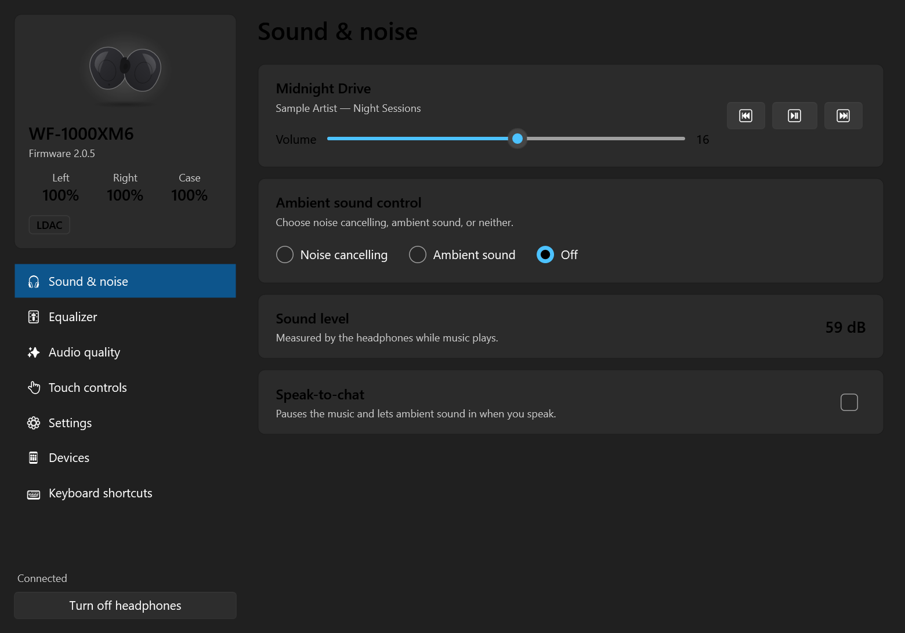

# Resonance

**Pilotez vos écouteurs Sony depuis Windows 11, sans téléphone.**

Resonance est une application Windows native (C# / .NET 10, design Fluent) qui parle aux casques Sony
en Bluetooth, comme l'application mobile Sony Sound Connect. Réduction de bruit, égaliseur, batterie,
commandes tactiles : tout se règle depuis le PC, un raccourci clavier ou la ligne de commande.



*[English version](README.md)*

## Fonctionnalités

- **Contrôle du bruit** : réduction de bruit, son ambiant (niveau 1 à 20, voix, mode automatique), désactivé
- **Égaliseur 10 bandes** avec préréglages et courbe personnalisée
- **Batterie** de chaque écouteur et du boîtier, codec (LDAC / AAC / SBC), morceau en cours, volume
- **Audio** : DSEE Extreme, priorité de connexion, musique de fond
- **Détection de conversation** avec sensibilité et délai
- **Commandes tactiles** : preset par écouteur, gestes, accès rapide, gestes de la tête
- **Appareils** : voir, connecter, déconnecter, oublier et basculer entre les appareils (multipoint)
- **Paramètres** : extinction auto, recharge douce, retour de voix, guidage vocal, assistant vocal, test des embouts
- **Bonus Windows** : icône dans la zone de notification (un clic change le mode), raccourcis clavier globaux,
  démarrage avec Windows, ligne de commande scriptable, thème clair / sombre, anglais et français

## Casques pris en charge

| Modèle | État |
|---|---|
| WF-1000XM6 | Entièrement testé (chaque réglage vérifié sur le casque) |
| Autres casques Sound Connect (WF-1000XM5, WH-1000XM5/XM6, LinkBuds…) | Connexion attendue, fonctions variables. [Aidez à ajouter le vôtre](CONTRIBUTING.md#add-support-for-your-headphones) |

## Installation

1. Appairez le casque avec Windows (Paramètres → Bluetooth et appareils) et connectez-le.
2. Téléchargez `Resonance-win-x64.zip` depuis la [dernière version](../../releases/latest) et décompressez-le.
3. Lancez `Resonance.exe` : il trouve le casque tout seul.

Rien à installer, pas de runtime .NET nécessaire. Les exécutables ne sont pas encore signés : au premier
lancement, SmartScreen peut demander une confirmation (« Informations complémentaires » → « Exécuter quand même »).

La langue suit celle de Windows ; elle se change dans Paramètres → Langue.

## Ligne de commande

```text
resonance-cli etat                 batterie, mode, codec, morceau en cours
resonance-cli nc                   réduction de bruit
resonance-cli ambiant 12           son ambiant, niveau 12
resonance-cli desactive | bascule
resonance-cli eq puissant          préréglage d'égaliseur (eq : liste)
resonance-cli volume 12 | lecture | pause | suivant | precedent
resonance-cli appareils | connecter telephone
resonance-cli aide
```

Les noms anglais (`status`, `ambient`, `toggle`…) fonctionnent aussi.

Le reste de la documentation (fonctionnement, compilation, contribution) est en anglais dans le
[README principal](README.md).

## Avertissement

Resonance est un projet indépendant, sans lien avec Sony. Sony, WF-1000XM6, LDAC, DSEE Extreme et
Sound Connect sont des marques de Sony Group Corporation. Le protocole a été documenté à des fins
d'interopérabilité ; aucun code ni élément graphique de Sony n'est inclus.

## Licence

[GPL-3.0](LICENSE)
