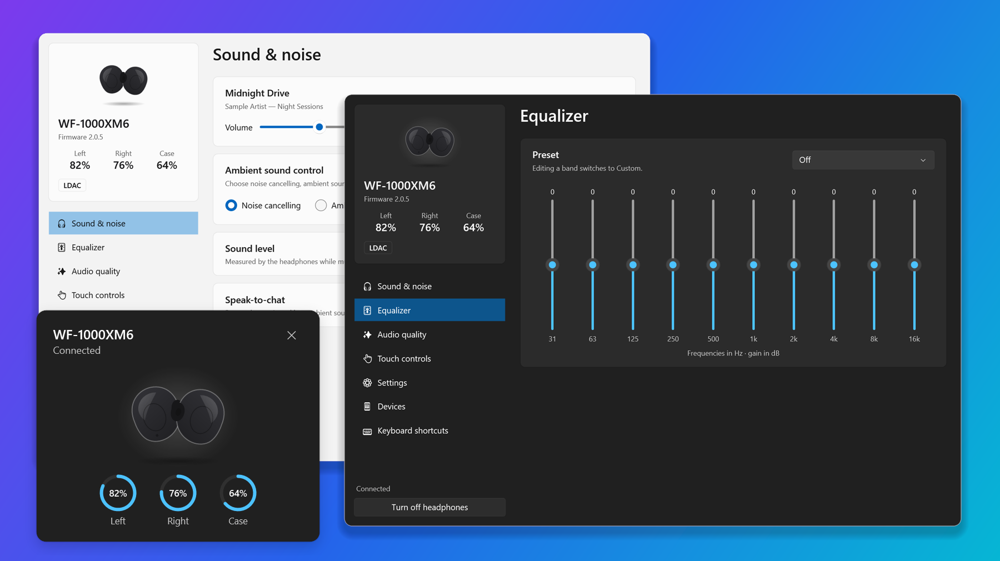
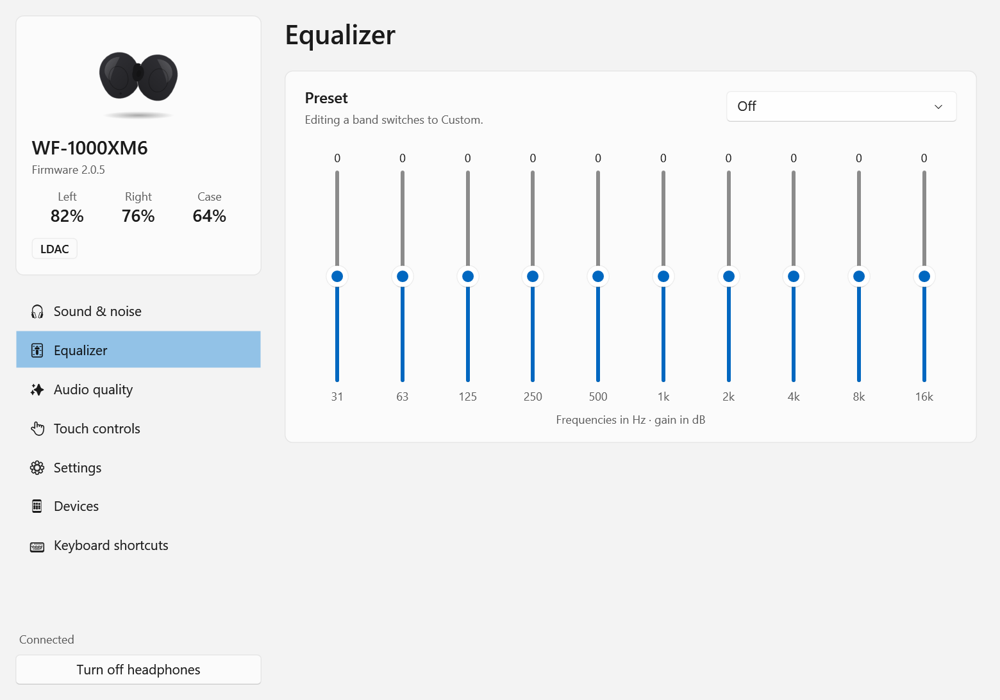
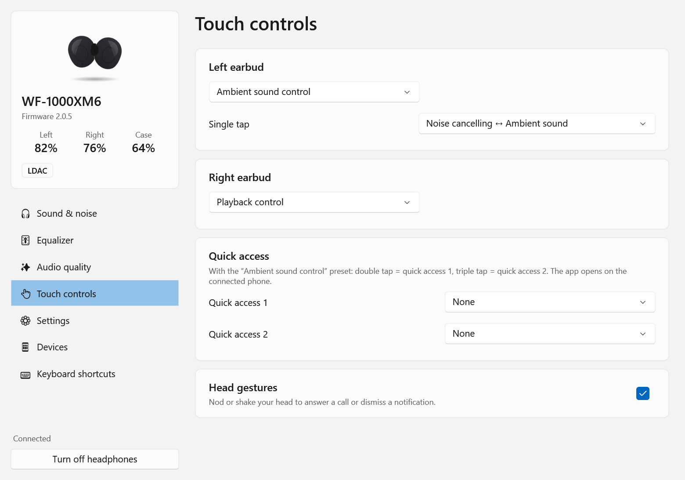
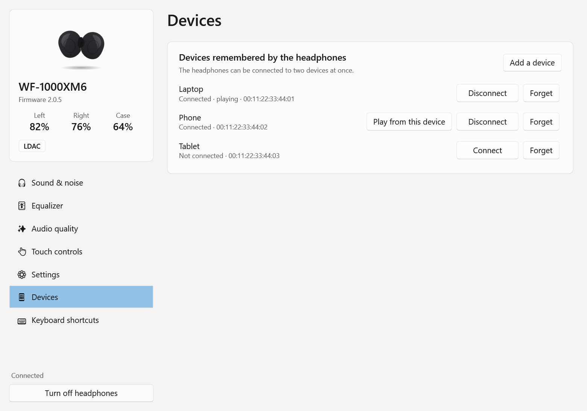
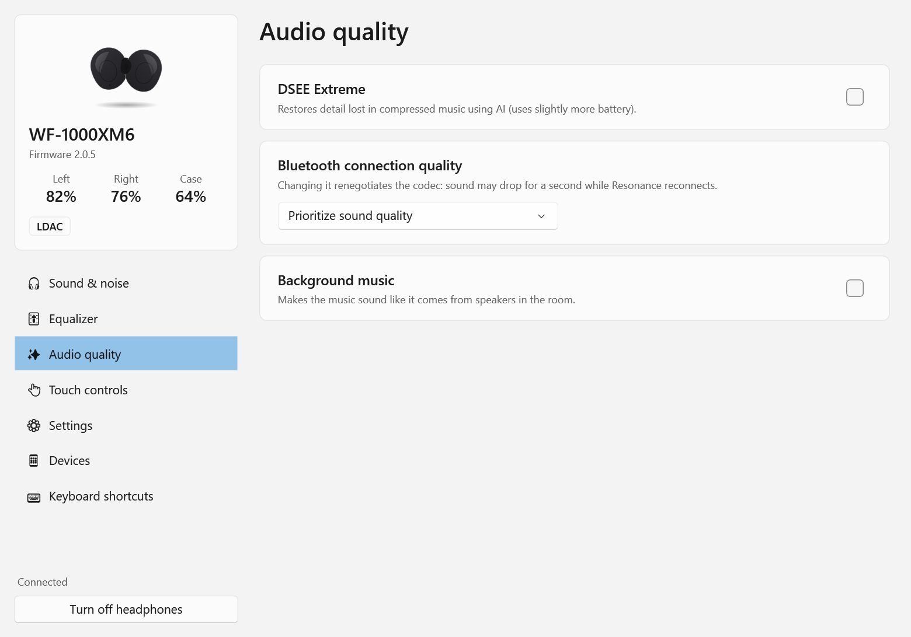
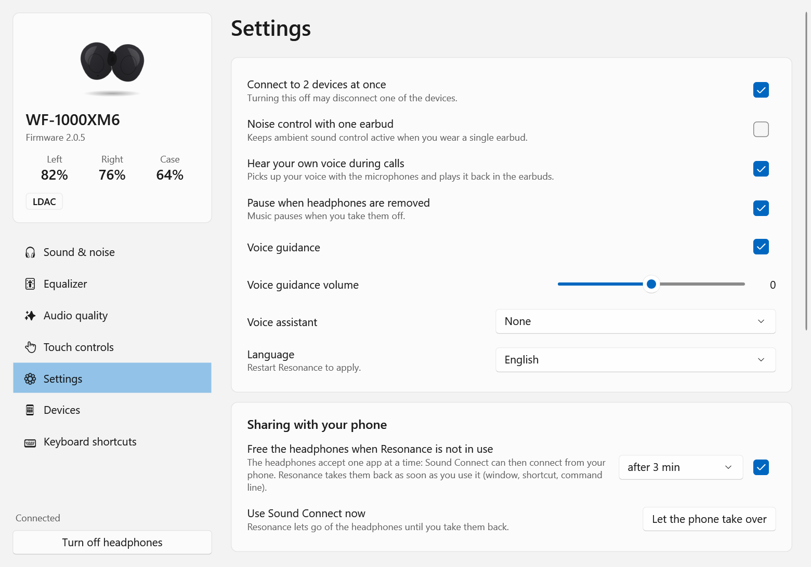
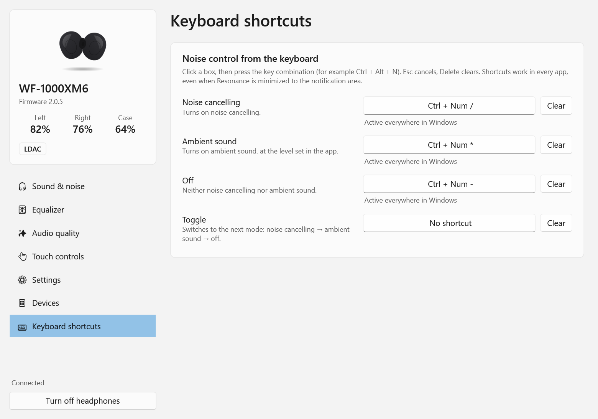

<p align="center">
  <picture>
    <source media="(prefers-color-scheme: dark)" srcset="docs/images/title-dark.png">
    <source media="(prefers-color-scheme: light)" srcset="docs/images/title-light.png">
    
  </picture>
</p>

<p align="center">
  <a href="../../releases/latest"></a>
  
  
  
  <a href="LICENSE"></a>
</p>

<p align="center">
  <strong>English</strong> | <a href="README.fr.md">Français</a>
</p>

---

**Control your Sony headphones from Windows, no phone needed.** Switch noise cancelling, tune the equalizer,
check the battery and remap the touch controls from a native Fluent app, a keyboard shortcut or the command line.

Looking for **Sony Sound Connect (formerly Headphones Connect) on PC**? Sony only makes it for phones.
Resonance brings its settings to Windows, with no emulator.

<p align="center">
  <a href="../../releases/latest"></a>
</p>



## Features ✨

- 🎧 **Noise control**: noise cancelling, ambient sound with level and voice focus, off
- 🎚️ **Equalizer**: presets and custom curves, with the bands your model offers
- 🔋 **Battery at a glance**: each earbud, the case or the headband, plus an animated card when they connect
- ⌨️ **Global keyboard shortcuts** for noise modes, in every app
- 👆 **Touch controls**: presets, gestures, quick access and head gestures
- 📱 **Multipoint devices**: connect, disconnect and switch between your devices
- ✨ **Audio**: DSEE Extreme, connection priority, background music, voice boost
- 📊 **Live sound level** measured by the headphones
- 🖥️ **Made for Windows**: notification area icon, light and dark themes, start with Windows, command line

## A closer look 🖼️

<table>
  <tr>
    <td align="center"><b>Equalizer</b></td>
    <td align="center"><b>Touch controls</b></td>
    <td align="center"><b>Devices</b></td>
  </tr>
  <tr>
    <td><picture><source media="(prefers-color-scheme: dark)" srcset="docs/images/equalizer.png"></picture></td>
    <td><picture><source media="(prefers-color-scheme: dark)" srcset="docs/images/touch.png"></picture></td>
    <td><picture><source media="(prefers-color-scheme: dark)" srcset="docs/images/devices.png"></picture></td>
  </tr>
  <tr>
    <td align="center"><b>Audio quality</b></td>
    <td align="center"><b>Settings</b></td>
    <td align="center"><b>Keyboard shortcuts</b></td>
  </tr>
  <tr>
    <td><picture><source media="(prefers-color-scheme: dark)" srcset="docs/images/quality.png"></picture></td>
    <td><picture><source media="(prefers-color-scheme: dark)" srcset="docs/images/settings.png"></picture></td>
    <td><picture><source media="(prefers-color-scheme: dark)" srcset="docs/images/shortcuts.png"></picture></td>
  </tr>
</table>

## Supported headphones 🎧

Resonance asks your headphones what they support and only shows those settings.

| | Models | Status |
|---|---|---|
| ✅ | WF-1000XM6 | Every setting tested on the device |
| 🧪 | WF-1000XM5, LinkBuds Clip, WH-1000XM3 | Checked against recorded sessions; changing settings not yet confirmed by an owner |
| 🔶 | WH-1000XM4/XM5/XM6, WF-1000XM4, WF-C700N, other LinkBuds… | Should work: same protocols. [Help confirm yours](CONTRIBUTING.md#add-support-for-your-headphones) |

## How to install 📥

1. Pair your headphones with Windows (**Settings → Bluetooth & devices**) and connect them.
2. Download `Resonance-win-x64.zip` from the [latest release](../../releases/latest) and unzip it anywhere.
3. Run `Resonance.exe`. It finds your headphones by itself.

There is nothing else to install. The app is not code-signed yet, so Windows SmartScreen may ask you to confirm
the first launch (**More info → Run anyway**).

Closing the window keeps Resonance in the notification area: click the icon for quick settings (mode, equalizer, pin playback), right-click
for the menu. The icon shows the current mode: blue for noise cancelling, green for ambient sound, white for off, and
grey when disconnected.

## Good to know 💡

<details>
<summary><b>Using Sound Connect on your phone too</b></summary>

<br>

Headphones accept one control app at a time. Resonance lets go of them after a few minutes without use
(**Settings → Sharing with your phone**) and takes them back as soon as you open the window, press a shortcut or
run a command. **Let the phone take over** frees them right away, until you choose **Take back control**.

</details>

<details>
<summary><b>Keyboard shortcuts</b></summary>

<br>

In **Keyboard shortcuts**, click a box and press a combination (Ctrl, Alt, Shift or Win + a key; F1-F24 and media
keys work alone). Available actions: noise cancelling, ambient sound, off and toggle.

</details>

<details>
<summary><b>Command line</b></summary>

<br>

```text
resonance-cli status               battery, mode, codec, now playing
resonance-cli nc                   noise cancelling
resonance-cli ambient 12           ambient sound, level 12
resonance-cli off | toggle
resonance-cli eq heavy             equalizer preset (eq: list them)
resonance-cli volume 12 | play | pause | next | prev
resonance-cli devices | connect phone | disconnect laptop
resonance-cli release | resume     leave the headphones to the phone / take them back
resonance-cli help
```

Exit codes: `0` success, `1` command error, `2` no headphones, `3` cannot connect. French command names work too.

</details>

<details>
<summary><b>Your own picture and animation</b></summary>

<br>

**Settings → Appearance** can replace the drawing of your headphones with a picture of your choice, and play a
folder of numbered PNG images when they connect. These files stay on your PC.

</details>

<details>
<summary><b>For developers</b></summary>

<br>

Requires the .NET 10 SDK on Windows 10 (1809) or later.

```powershell
dotnet run --project src/Resonance.App        # run the app
./publish.ps1                                 # self-contained executables + Start menu shortcut
```

| Folder | Role |
|---|---|
| `src/Resonance.Core` | MDR protocol, Bluetooth link, headphones model, commands, translations |
| `src/Resonance.App` | WPF Fluent app, notification area icon, keyboard shortcuts |
| `src/Resonance.Cli` | Command line and protocol tools |
| `docs/` | [Protocol specification](docs/PROTOCOL.md) and feature matrix |

</details>

## Contributing 🤝

Translations, support for more models and bug reports are very welcome: see [CONTRIBUTING.md](CONTRIBUTING.md).

The layouts of other models were cross-checked against the recorded sessions and device notes of
[mos9527/SonyHeadphonesClient](https://github.com/mos9527/SonyHeadphonesClient) (MIT). Thank you!

## Disclaimer ⚠️

Resonance is an independent project. It is not affiliated with, endorsed by or sponsored by Sony.
Sony, WF-1000XM6, LDAC, DSEE Extreme and Sound Connect are trademarks of Sony Group Corporation.
The protocol was documented for interoperability; no Sony code or assets are included. Use at your own risk.

## License 📜

Free for personal and other noncommercial use under the [PolyForm Noncommercial License 1.0.0](LICENSE).
Commercial use, including selling Resonance or a modified copy, is not covered and needs the author's permission.

Versions up to 1.1.0 were released under GPL-3.0 and remain available under that license.
