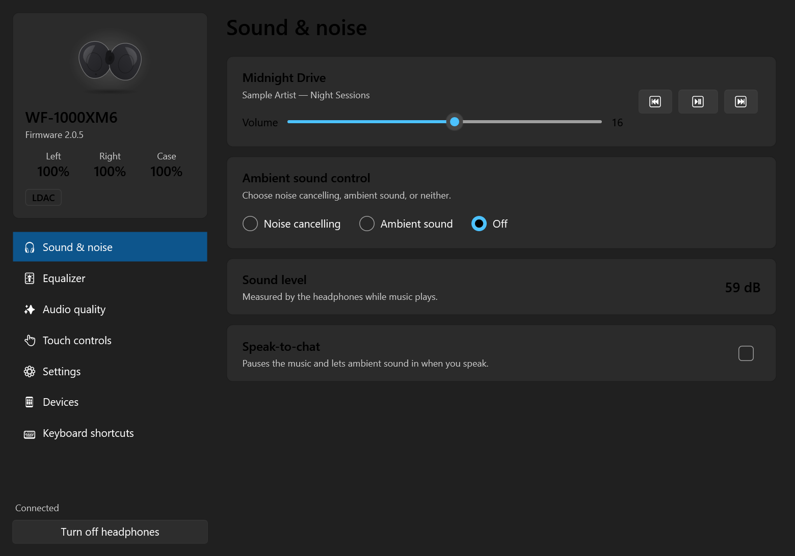
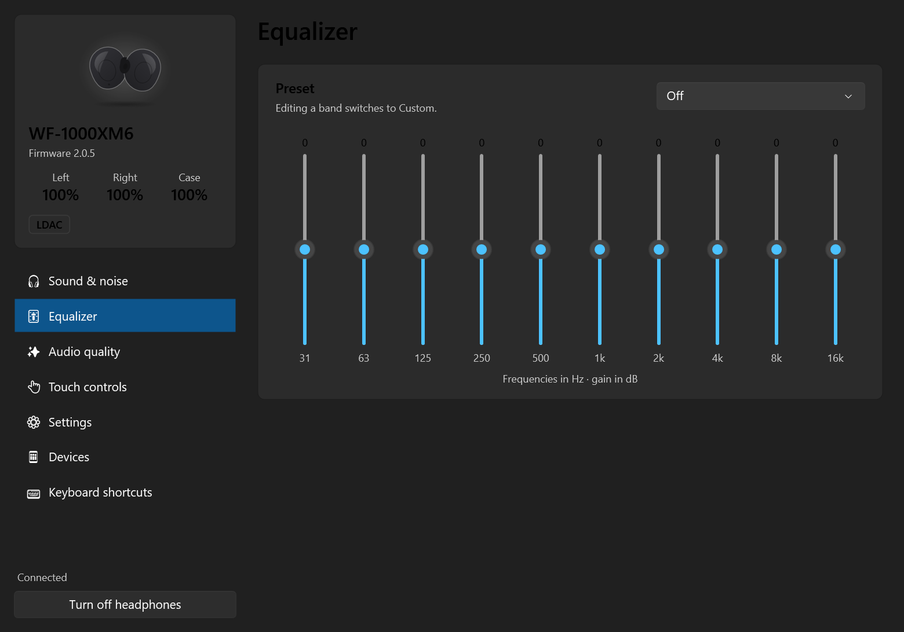
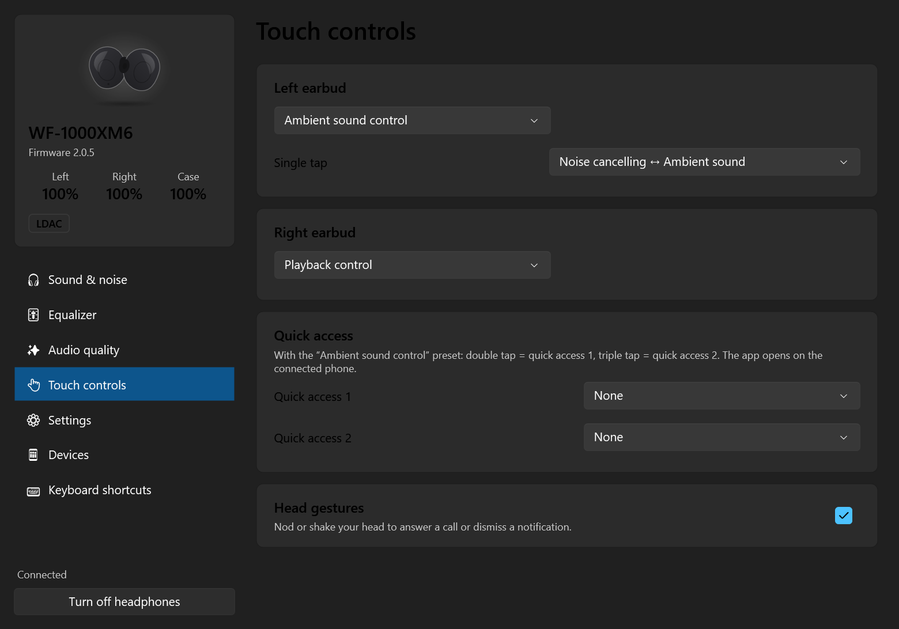
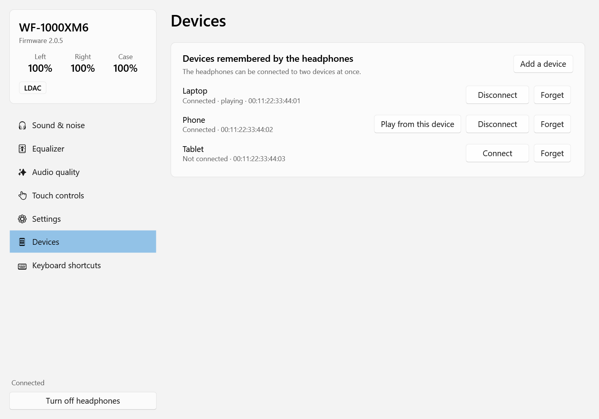
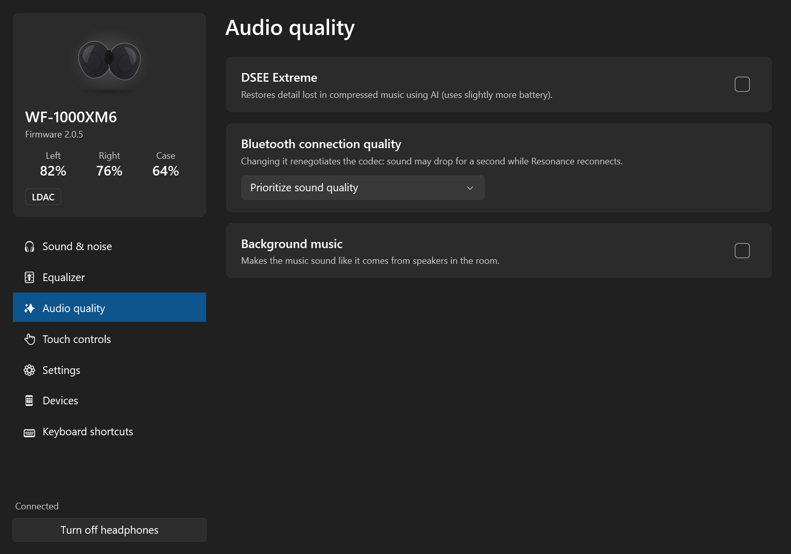
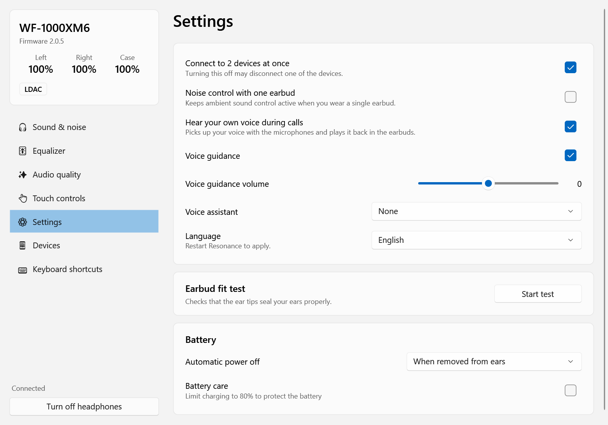
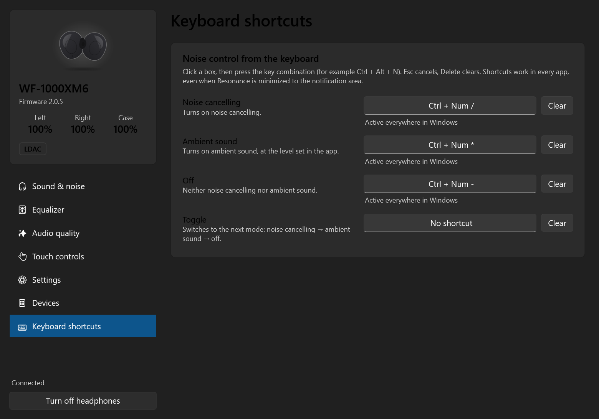

# Resonance

**Control your Sony headphones from Windows 11. No phone needed.**

Resonance is a native Windows app (C# / .NET 10, Fluent design) that talks to Sony headphones over
Bluetooth, the same way the Sony Sound Connect phone app does. Switch noise cancelling, tweak the
equalizer, check the battery or remap the touch controls from your PC, a keyboard shortcut or the
command line.

Looking for **Sony Sound Connect (formerly Headphones Connect) on PC**? Sony only makes the app for
phones. Resonance brings its settings to Windows 10 and 11, with no emulator and no phone.



*[Version française](README.fr.md)*

## Features

- **Noise control**: noise cancelling, ambient sound (level 1-20, voice focus, auto ambient), off
- **Equalizer** with presets and custom curves: 10 bands, or Clear Bass + 5 bands, as the model offers
- **Battery** for each earbud and the case (or the headband), codec (LDAC / AAC / SBC), now playing, volume
- **Sound level**: the live level the headphones measure while music plays (safe listening)
- **Audio**: DSEE Extreme, connection priority, background music, voice boost, sound leakage reduction
- **Speak-to-chat** with sensitivity and timeout
- **Touch controls**: presets for each earbud, gesture mapping, quick access, head gestures
- **Devices**: see, connect, disconnect, forget and switch between paired devices (multipoint)
- **Settings**: auto power off, battery care, sidetone, pause when removed, voice guidance, voice assistant,
  earbud fit test, plus any model-specific setting the headphones describe themselves (tap sensitivity…)
- **Windows-only extras**: notification area icon (click to cycle noise modes), global keyboard shortcuts,
  start with Windows, a scriptable command line, light / dark theme, English and French

## Screenshots

| Equalizer | Touch controls | Devices |
|---|---|---|
|  |  |  |
| **Audio quality** | **Settings** | **Keyboard shortcuts** |
|  |  |  |

## Supported headphones

Resonance asks the headphones which functions they support and only shows those, in the layout each
model uses (noise control, equalizer, battery and listening mode variants).

| Model | Status |
|---|---|
| WF-1000XM6 | Fully tested (every setting verified on the device) |
| WF-1000XM5, LinkBuds Clip | Every page checked against recorded sessions; changing settings not yet confirmed by an owner |
| Other Sound Connect headphones (WH-1000XM5/XM6, WF-C700N, LinkBuds…) | Should work: same protocol and variants. [Help confirm yours](CONTRIBUTING.md#add-support-for-your-headphones) |
| Older models (WH-1000XM3/XM4, WF-1000XM3/XM4) | Not yet: they use the first version of the protocol |

## Install

1. Pair your headphones with Windows (Settings → Bluetooth & devices) and connect them.
2. Download `Resonance-win-x64.zip` from the [latest release](../../releases/latest) and unzip it anywhere.
3. Run `Resonance.exe`. It finds your headphones by itself.

No installation and no .NET runtime are needed. The executables are not code-signed yet, so Windows
SmartScreen may ask you to confirm the first launch ("More info" → "Run anyway").

Closing the window keeps Resonance in the notification area: left-click the icon to cycle noise
modes, double-click to open it. Run `Resonance.exe --background` to start minimized (useful in the
Startup folder).

## Keyboard shortcuts

In **Keyboard shortcuts**, click a box and press a combination (Ctrl, Alt, Shift or Win + a key; F1-F24
and media keys work alone). Available actions: noise cancelling, ambient sound, off, toggle. Shortcuts
work in every app, even when Resonance is minimized.

## Command line

```text
resonance-cli status               battery, mode, codec, now playing
resonance-cli nc                   noise cancelling
resonance-cli ambient 12           ambient sound, level 12
resonance-cli off | toggle
resonance-cli eq heavy             equalizer preset (eq: list them)
resonance-cli eq bands 2 1 0 0 0 0 1 2 3 2
resonance-cli dsee on | bgm on living | stc off
resonance-cli volume 12 | play | pause | next | prev
resonance-cli devices | connect phone | disconnect laptop
resonance-cli help
```

When the app is open, commands go through it and answer in about 0.2 s; otherwise the CLI connects
directly (about 1 s). Exit codes: `0` success, `1` command error, `2` no headphones, `3` cannot connect.
French command names work too (`etat`, `ambiant`, `bascule`…).

## How it works

Sony headphones expose a serial (RFCOMM) control service. Resonance speaks its "MDR" protocol: framed
messages with a command byte and a variant byte, acknowledged one at a time. The full byte-level
specification, with the evidence for each command, is in [docs/PROTOCOL.md](docs/PROTOCOL.md).

The headphones accept a single control connection per PC, so the command line forwards its commands to
the running app through a local named pipe.

## Build from source

Requires the .NET 10 SDK on Windows 10 (1809) or later.

```powershell
dotnet run --project src/Resonance.App        # run the app
./publish.ps1                                 # self-contained executables + Start menu shortcut
```

| Folder | Role |
|---|---|
| `src/Resonance.Core` | MDR framing, RFCOMM link (WinRT), headphones model, commands, translations |
| `src/Resonance.App` | WPF Fluent app, notification area icon, keyboard shortcuts |
| `src/Resonance.Cli` | Command line and protocol tools (`scan`, `deepscan`, `send`, `listen`, `test`) |
| `docs/` | Protocol specification and feature matrix |

`resonance-cli test` changes each setting on the connected headphones, waits for their confirmation and
restores the original value. Multipoint, power off and connection priority are left out because they
can drop a connection.

## Contributing

Translations, support for more models and bug reports are very welcome: see [CONTRIBUTING.md](CONTRIBUTING.md).

## Acknowledgements

The variant layouts for other models were cross-checked against the recorded sessions and device notes of
[mos9527/SonyHeadphonesClient](https://github.com/mos9527/SonyHeadphonesClient) (MIT), the most thorough
open-source work on these headphones.

## Disclaimer

Resonance is an independent project. It is not affiliated with, endorsed by or sponsored by Sony.
Sony, WF-1000XM6, LDAC, DSEE Extreme and Sound Connect are trademarks of Sony Group Corporation.
The protocol was documented for interoperability; no Sony code or assets are included. Use at your
own risk.

## License

[GPL-3.0](LICENSE)
